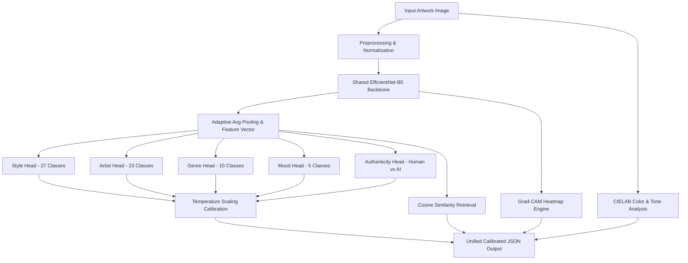

# ArtVision 🎨🔍

> **An Explainable Multi-Task Deep Learning Framework for Comprehensive Artwork Analysis**

[](https://www.python.org/downloads/)
[](https://pytorch.org/)
[](https://fastapi.tiangolo.com/)
[](https://react.dev/)
[](https://www.typescriptlang.org/)
[](https://opensource.org/licenses/MIT)

---

## 📌 Project Overview

**ArtVision** is a multi-task deep learning system designed for museum-grade artwork analysis and authentication. By uploading a single artwork image, ArtVision simultaneously performs:

1. **Art Style & Movement Classification**: Predicts across 27 art historical styles and maps to unified art historical movements and eras.
2. **Artist Attribution & Genre Recognition**: Identifies master painters and genre categories with calibrated uncertainty.
3. **Authenticity Detection (Human vs. AI)**: Detects whether an artwork is human-created or synthesized by generative models (Stable Diffusion / Latent Diffusion) with **97.06% accuracy** and **0.995 AUROC**.
4. **Dominant Color Palette & Tone Analysis**: Perceptually uniform CIELAB K-Means clustering with $\Delta E$ near-duplicate swatch merging and temperature/tone descriptors (~53ms latency).
5. **Explainable AI (Grad-CAM)**: Visual attribution heatmaps highlighting the exact brushwork, facial features, or structural cues driving predictions.
6. **Visual Similarity Retrieval**: Nearest-neighbor artwork search using deep feature embeddings.

---

## 🏛️ System Architecture



---

## 📊 Benchmark Results (Test Set, N = 816)

| Prediction Task | Top-1 Accuracy | Top-3 Accuracy | Macro F1-Score | Calibrated ECE | Metric Highlight |
| :--- | :---: | :---: | :---: | :---: | :--- |
| **Authenticity** (Human vs AI) | **97.06%** | 100.0% | **0.935** | **0.0107** | **AUROC: 0.995** |
| **Derived Movement** | **72.01%** | 100.0% | 0.720 | — | 7 Art Historical Eras |
| **Genre Recognition** | **66.35%** | **94.04%** | 0.565 | 0.0664 | 94.0% Top-3 Precision |
| **Artist Attribution** | **65.05%** | **82.61%** | 0.625 | 0.0439 | 82.6% Top-3 Precision |
| **Style Classification** | **59.93%** | **84.22%** | 0.434 | 0.0442 | 84.2% Top-3 Precision |
| **Color Extraction** | — | — | — | — | **53.6 ms** CPU Latency |

---

## 🗂️ Repository Structure

```
.
├── README.md                      # Project documentation
├── predict.py                     # Root CLI prediction wrapper
├── showcase/                      # Publication-ready visualizations & interactive showcase
│   ├── index.html                 # Standalone web presentation dashboard
│   ├── SHOWCASE_GUIDE.md          # Viva defense guide & empirical analysis
│   ├── generate_showcase.py       # High-DPI figure generator script
│   ├── dataset/                   # Dataset distribution and sample figures
│   ├── evaluation/                # Training dynamics, calibration curves, confusion matrices
│   └── results/                   # Grad-CAM, color palette, and retrieval figures
└── artvision/                     # Core system package
    ├── api/                       # FastAPI backend application
    │   └── main.py
    ├── configs/                   # Model, data, color, and prediction YAML configs
    ├── frontend/                  # React + TypeScript + Tailwind CSS user interface
    ├── notebooks/                 # Exploratory data analysis notebooks
    ├── scripts/                   # Training, validation, and evaluation scripts
    ├── src/                       # Machine learning source modules
    │   ├── data/                  # Custom dataset loaders and transforms
    │   ├── explain/               # Grad-CAM implementation and border mass fraction
    │   ├── features/              # CIELAB color palette extractor
    │   ├── models/                # Multi-task architecture and task heads
    │   ├── similarity/            # Vector similarity search engine
    │   ├── training/              # Multi-task loss, calibration, and training loops
    │   └── utils/                 # Metrics, logging, and checkpointing
    ├── tests/                     # Unit and integration test suite
    └── requirements.txt           # Python dependencies
```

---

## ⚡ Quick Start

### 1. Prerequisites
- Python 3.10 or higher
- Node.js 18+ & npm

### 2. Backend Setup
```bash
# Navigate to artvision
cd artvision

# Create and activate virtual environment
python3 -m venv venv
source venv/bin/activate    # On Windows: venv\Scripts\activate

# Install dependencies
pip install -r requirements.txt
```

### 3. Run Inference via CLI
```bash
# Run prediction with Grad-CAM visual explanation
python3 predict.py --image path/to/artwork.jpg --explain --explain-task style
```

### 4. Start the API Server
```bash
cd artvision
python3 -m uvicorn api.main:app --host 0.0.0.0 --port 8000 --reload
```
API Documentation will be available at `http://localhost:8000/docs`.

### 5. Start Frontend UI
```bash
cd artvision/frontend
npm install
npm run dev
```
Open `http://localhost:5173` in your browser.

### 6. Interactive Showcase Dashboard
To view the evaluation showcase and publication figures, simply open `showcase/index.html` in any web browser.

---

## 🔬 Multi-Task Loss Weighting

To balance diverse classification heads with varying loss scales and sample sizes, ArtVision supports multiple loss balancing strategies:

- **Homoscedastic Uncertainty Weighting** (Kendall et al.):
  $$\mathcal{L}_{\text{total}} = \sum_{t} \left( \frac{1}{2\sigma_t^2} \mathcal{L}_t + \log \sigma_t \right)$$
  Where task-dependent observation noise $\sigma_t$ is learned dynamically via gradient descent.
- **Dynamic Task Loss Masking**: Artworks lacking specific labels (e.g., synthetic ArtBench artworks without artist attribution) have their head losses zeroed during backpropagation without discarding the image:
  $$\mathcal{L} = \sum_{t} m_t \cdot w_t \cdot \mathcal{L}_t, \quad m_t \in \{0, 1\}$$

---

## 🎨 Color Palette & Tone Extraction

Implemented via `src/features/color_palette.py`:
- Converts images to perceptually uniform **CIELAB** space (`cv2.COLOR_RGB2LAB`).
- Performs K-Means clustering ($K=5$) and merges near-duplicate swatches with $\Delta E_{76} < 12.0$.
- Computes continuous temperature scores (`warm_score`, `cool_score` $\in [0, 1]$) based on chroma-weighted hue voting.
- Classifies tone into light/mid/dark, saturation into muted/balanced/vivid, and detects pastel aesthetics.

---

## 🧪 Running Tests

```bash
cd artvision
pytest tests/ -v
```

---

## 📜 License

This project is licensed under the MIT License.
